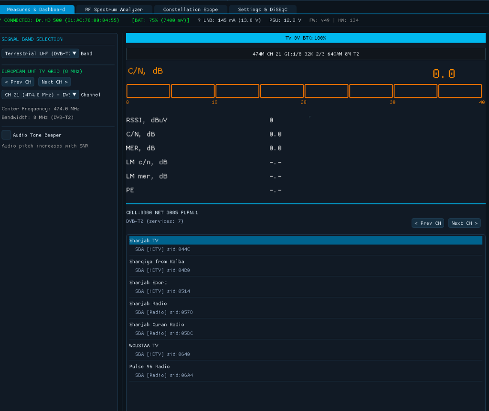
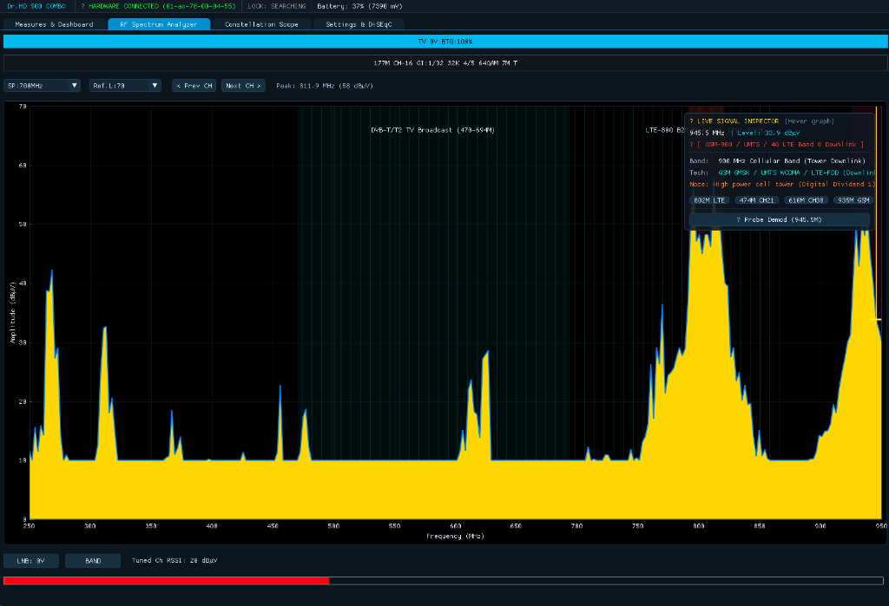
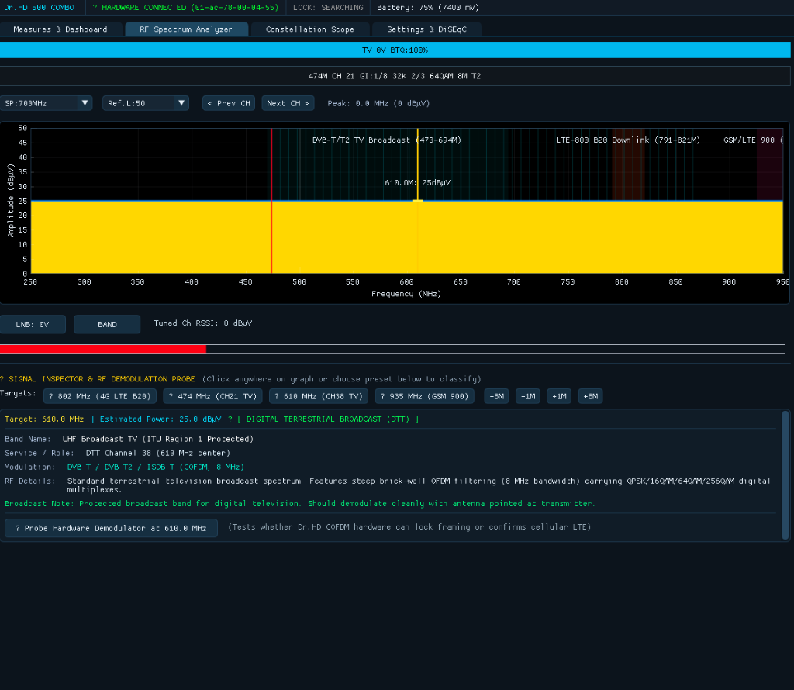
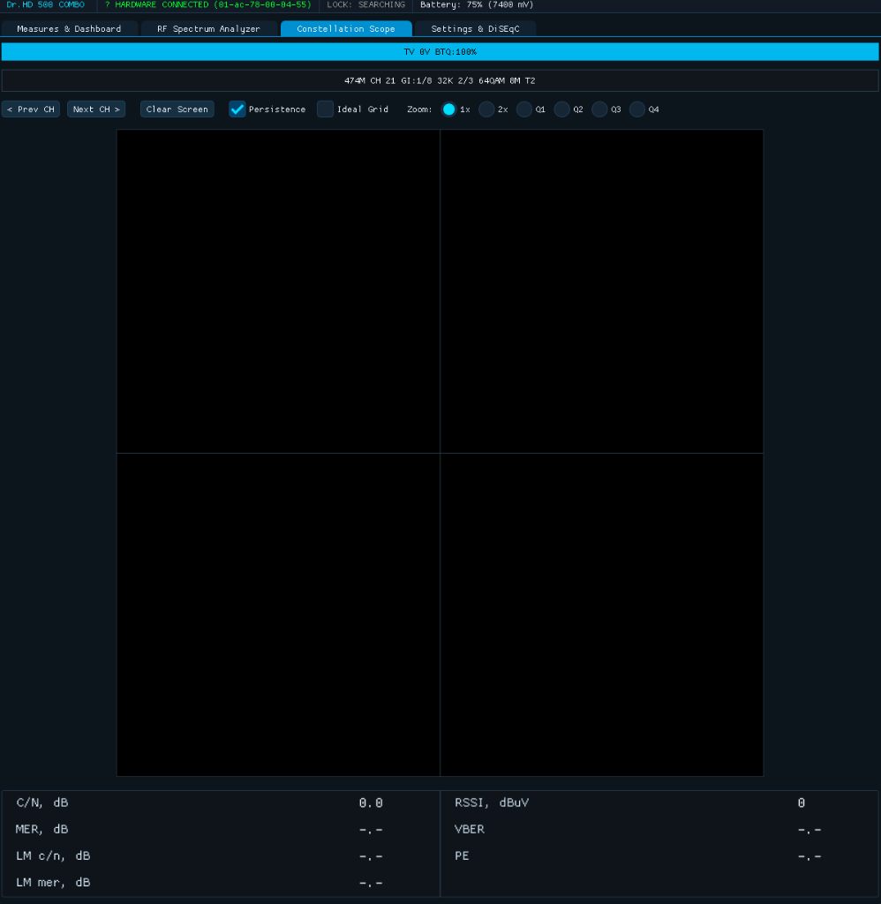
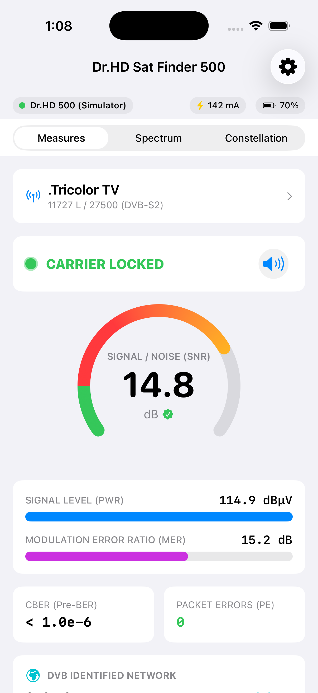
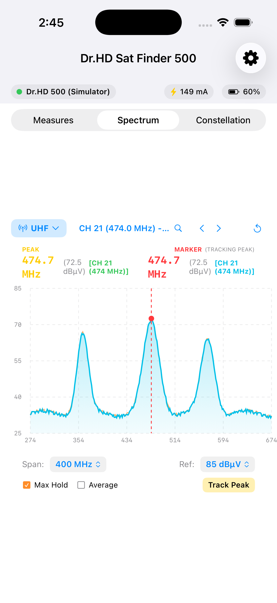
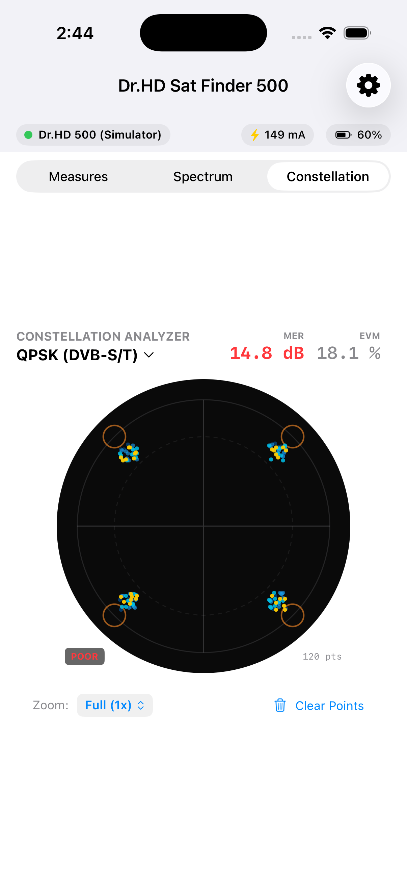

# Dr.HD 500 Combo — RF Spectrum Analyser & Multi-Platform Suite

A complete multi-platform software suite for the **Dr.HD 500 Combo Satellite & Terrestrial Signal Meter / Sat Finder** (DVB-S/S2/T/T2/C), built by reverse-engineering the proprietary Bluetooth SPP binary telemetry protocol.

Includes:
- **macOS Desktop Analyser (`DrHD500-Desktop`)** — Native C++17 application using Dear ImGui, ImPlot, GLFW, OpenGL, and Apple AudioToolbox.
- **iOS Companion App (`DrHD500-iOS`)** — Native SwiftUI application with CoreBluetooth BLE, Wi-Fi TCP, AVAudioEngine acoustic beeper, and a full built-in hardware simulator.
- **ESP32 Hardware Bridge (`DrHD500-ESP32`)** — PlatformIO firmware bridging Classic Bluetooth SPP from the Dr.HD 500 to BLE UART / Wi-Fi TCP for iOS devices.
- **macOS Serial-to-TCP Bridge (`drhd_serial_bridge.py`)** — Python bridge exposing `/dev/cu.DrHD500ComboBT` over TCP port `8080` for iOS.

---

## Screenshots

### macOS Desktop Analyser (Live Hardware)

| Measures & DVB-T2 Multiplex Dashboard | RF Spectrum Analyser & Live Signal Inspector |
| :---: | :---: |
|  |  |
| *Live DVB-T2 lock on CH 21 (474 MHz) displaying discovered NIT/SDT services (Sharjah TV, Sharqiya from Kalba, Sharjah Sport, etc.)* | *250–950 MHz RF sweep with Live Signal Inspector classifying DVB-T/T2, LTE-800, and GSM-900 bands* |

| Signal Inspector & RF Demodulation Probe | Phosphor I/Q Constellation Scope |
| :---: | :---: |
|  |  |
| *Interactive RF Demodulation Probe targeting CH 38 (610 MHz DTT)* | *1:1 Phosphor persistence I/Q constellation scope with quadrant zoom and MER/VBER/PE readouts* |

### iOS App (SwiftUI)

| Signal Dashboard | UHF Spectrum Sweep | QPSK Constellation Analyser |
| :---: | :---: | :---: |
|  |  |  |

---

## Components

### 1. `DrHD500-Desktop/` (macOS C++17)
- **Direct Bluetooth Serial:** Connects to `/dev/cu.DrHD500ComboBT` (115200 baud, 8N1) with `blueutil` link recovery and offline simulation fallback.
- **Measures & Dashboard:** SNR arc gauge, Signal Power ($dB\mu V$), MER (dB), Pre-BER, Uncorrected Packet Errors, and DVB NIT/SDT service explorer.
- **60 FPS RF Spectrum Analyser:** Cyan live sweep, orange Max Hold, green exponential moving average, peak tracking, draggable marker, and Live Signal Inspector (DVB-T/T2, LTE-800, GSM-900).
- **Phosphor Constellation Scope:** Multi-stage phosphor decay persistence with QPSK, 8-PSK, 16-QAM, 64-QAM, and 256-QAM overlays, live EVM/MER calculation, and quadrant zoom.
- **Settings & DiSEqC 1.0/1.1:** 4-port DiSEqC switch, 22 kHz tone, 13V/18V LNB voltage, raw hex DiSEqC injector, and battery/LNB current telemetry.
- **Acoustic Alignment Beeper:** Native `AudioToolbox` tone generator scaling pitch with SNR (500–2400 Hz).

### 2. `DrHD500-iOS/` (SwiftUI / iOS)
- **Three Transports:** Built-in Hardware Telemetry Simulator, CoreBluetooth BLE UART (FFE0 / Nordic NUS), and Wi-Fi / TCP Socket (`192.168.4.1:8080`).
- **Database & Motor Control:** 141 satellites, 2,970 transponders (`satellites.json`), 31 LNB LOF profiles (`converters.json`), DiSEqC 1.0/1.1/1.2, and USALS (Goto X).
- **Unit Tests:** `DrHD500Tests` verifying packet framing, 16-bit checksums, Maxim CRC-8, and RF telemetry math.

### 3. `DrHD500-ESP32/` & `drhd_serial_bridge.py`
- **`DrHD500-ESP32`:** PlatformIO ESP32 project bridging Classic Bluetooth SPP (required by the Dr.HD 500) to BLE/TCP for iOS.
- **`drhd_serial_bridge.py`:** Lightweight Python 3 bridge (`pyserial`) forwarding `/dev/cu.DrHD500ComboBT` to TCP port `8080`.

---

## Hardware Protocol Summary

| Property | Value | Details |
| :--- | :--- | :--- |
| **Transport** | Classic Bluetooth SPP | UUID `00001101-0000-1000-8000-00805F9B34FB`, 115200 8N1 |
| **Sync Byte** | `0xFE` | Fixed inbound telemetry frame header |
| **Packet Length** | `104 bytes` | Fixed frame size |
| **Inbound Checksum** | Big-Endian 16-bit sum | $\sum_{i=0}^{101} \text{byte}[i] == (\text{byte}[102] \ll 8) \mid \text{byte}[103]$ |
| **Command CRC** | Maxim 1-Wire CRC-8 | Polynomial `0x8C`, initial value `0x00`, written in 2-byte chunks |
| **Polling Rate** | `130 ms` | Master polling interval for tuning, spectrum, and service tables |

---

## Quick Start & Build

### macOS Desktop App
Requires `cmake`, `glfw3`, and `pkg-config` (`brew install cmake glfw pkg-config`).
```bash
cd DrHD500-Desktop
cmake -B build -DCMAKE_BUILD_TYPE=Release
cmake --build build -j4
./build/DrHD500Desktop
```

### iOS App
Open `DrHD500-iOS/DrHD500.xcodeproj` in Xcode, or run the Swift unit tests:
```bash
cd DrHD500-iOS
swift test
```

### Python Serial Bridge (for iOS over Wi-Fi/TCP)
```bash
pip3 install pyserial
python3 drhd_serial_bridge.py
```

### ESP32 Bridge Firmware
```bash
cd DrHD500-ESP32
pio run --target upload
```
